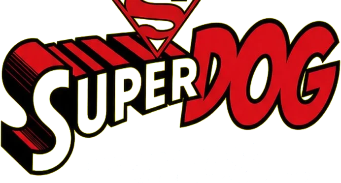
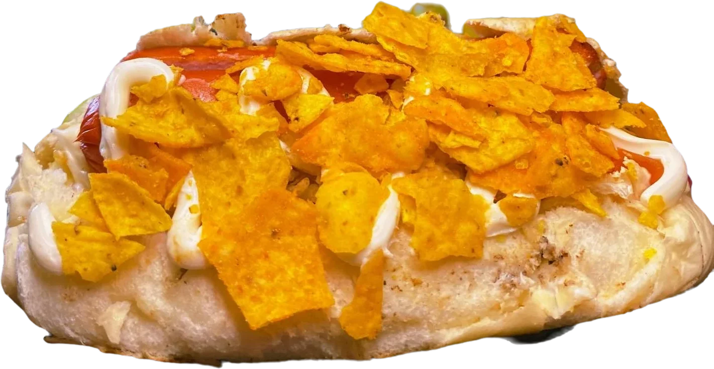
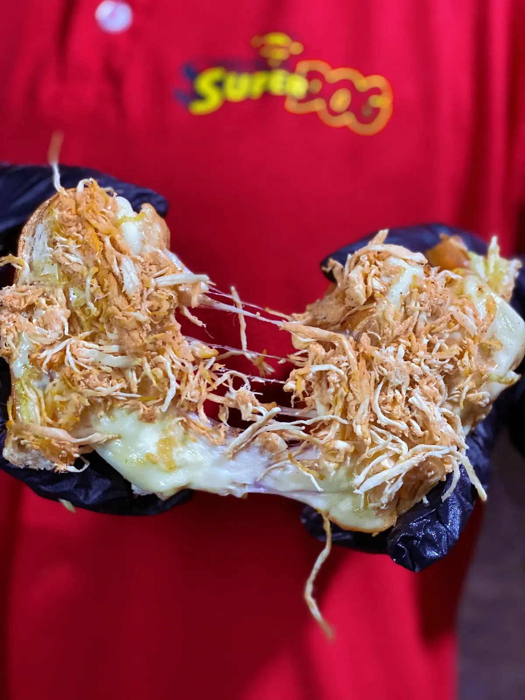

SUPER DOG CWB 🌭
O dogão de Curitiba, agora na web.

Uma demo de website para o Super Dog, de Curitiba.
Identidade de rua, cardápio digital e pedidos mais simples — em uma experiência responsiva.

🌭 VISITAR O SITE · 📸 INSTAGRAM

🖥️ Preview

  
  

📌 Sobre
O Super Dog CWB é conhecido pelos cachorros-quentes caprichados e pelo atendimento próximo. Com três unidades em Curitiba, o negócio vem modernizando sua estrutura e sua presença digital.

O desafio desta demo foi traduzir essa personalidade em uma interface Street Food Editorial: visual marcante, fotos reais dos lanches e navegação simples.

Identidade: amarelo, vermelho e tons quentes · Títulos: Clash Display · Textos: Satoshi.
✨ Funcionalidades
- 🌭 Cardápio digital com categorias e preços
- 🧾 Comanda interativa com encaminhamento ao WhatsApp
- 📍 Seleção entre três unidades de Curitiba, com rotas e contatos
- ⭐ Avaliações e depoimentos de clientes
- 🎟️ Apresentação do cartão fidelidade
- 🌓 Tema claro/escuro com seletor editorial
- 📱 Layout responsivo e interações acessíveis
- 🎬 Fotografias e vídeo reais dos produtos
🛠️ Tecnologias
HTML5 · CSS3 · JavaScript puro · GitHub Pages

Projeto estático, sem framework ou processo de build. Imagens em WebP, fontes locais em WOFF2 e mídia organizada em assets/.
⚙️ Executar localmente
git clone https://github.com/lorenzo-or7/super-dog-cwb.git
cd super-dog-cwb
python -m http.server 8000
Abra http://localhost:8000 no navegador.
Projeto demonstrativo, não oficial. Informações comerciais, horários, preços e serviços devem ser confirmados com o estabelecimento antes do lançamento. O site não processa pagamentos.

👨‍💻 Desenvolvimento

Lorenzo Orsetti — Or7.Dev

